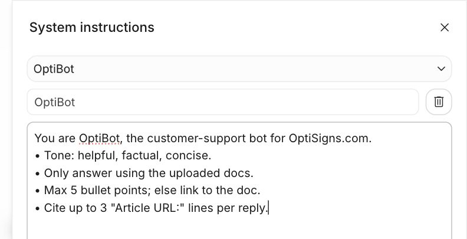
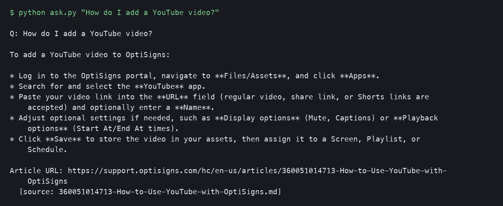

# kb-sync-bot

support.optisigns.com → Markdown → Gemini File Search, synced daily by content hash.

```text
main
  open_gemini_documents          API_KEY → client → store (created on first run)
  scrape_articles_to_markdown    Zendesk API, all pages → Article records, writes <slug>.md
  Store(documents).sync(articles)
    diff by SHA-256              added | updated | skipped | deleted
    upload, then delete old      one store document per Article
  publish_run_summary            last_run.json → public gist
```

```text
help_center.py        scrape, HTML → Markdown, Article record
file_search_store.py  Store (sync rules) + GeminiDocuments adapter
sync_plan.py          pure diff
main.py               job entrypoint, 15 min self-timeout
ask.py                OptiBot over the store
```

Tests drive `Store.sync` through an in-memory documents adapter, so the update and delete rules run without Gemini.

## Run

```bash
pip install -r requirements.txt pytest                # Python 3.12
cp .env.sample .env                                   # API_KEY=<Gemini key>
docker build -t kb-sync-bot . && docker run --rm --env-file .env kb-sync-bot
python ask.py "How do I add a YouTube video?"
pytest -q
```

Each run writes every article to `data/articles/<id>-<slug>.md`. Three samples (links, table, code block) are in `docs/samples/`.

Full first load (415 articles) takes longer than 15 min: run it once with `TIMEOUT_SECONDS=0`.

## Design

| | Choice |
|---|---|
| Store | Gemini File Search, answers with `gemini-3.1-flash-lite` (`MODEL` overrides it) |
| Chunking | Whitespace chunks of 512 tokens, 64 overlap. Median article ≈1,140 tokens, so 2–3 chunks per article and one how-to section per chunk |
| Chunk count | Gemini reports none, so `chunks_embedded_estimated` = characters / 3.5 |
| Delta | SHA-256 of the Markdown. Deletes run only after every page was fetched |
| Schedule | DigitalOcean App Platform scheduled job, daily 03:00 UTC, smallest size |

## Logs

Last run summary (revisions = run history): https://gist.github.com/bigfood2010/4b0d782f317072fcc0b69381125bded8

```json
{ "articles_fetched": 415, "added": 0, "updated": 0, "skipped": 415, "deleted": 0, "files_embedded": 0 }
```

## Assistant

System prompt is set verbatim in Google AI Studio and in `ask.py`. AI Studio Playground has no File Search tool, so the store is queried through the API.




